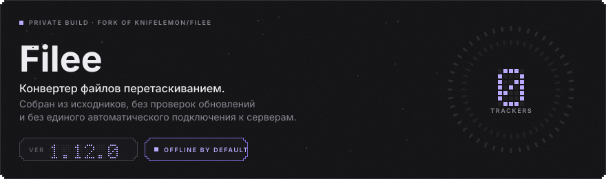
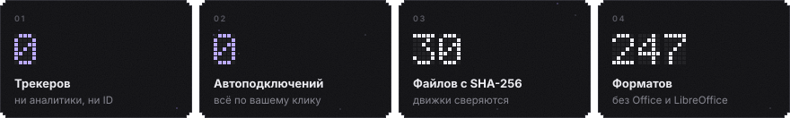
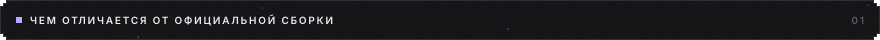
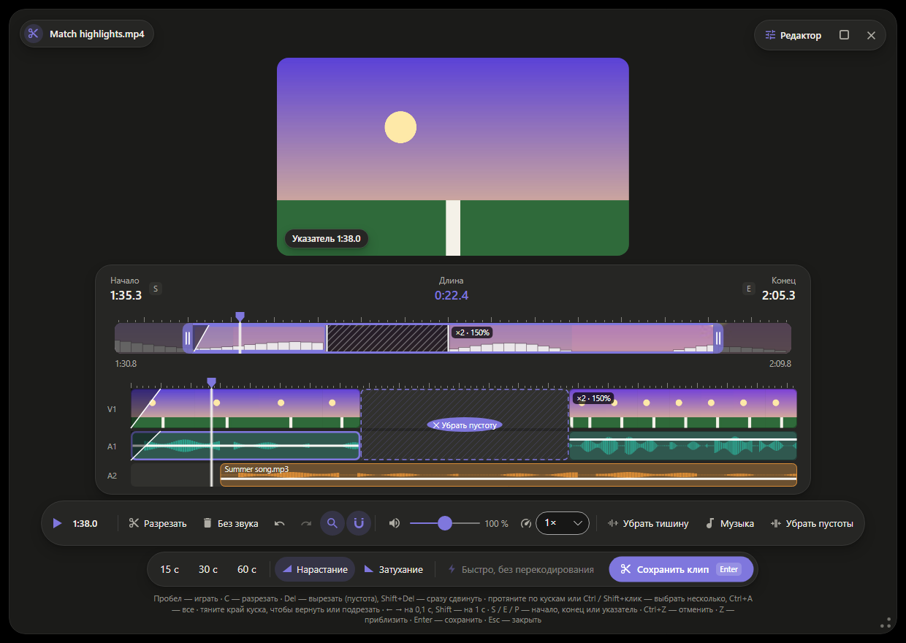
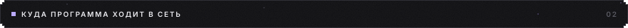

<p align="center">
  
</p>
<p align="center">
  
</p>

<p align="center">
  <a href="https://github.com/flexeykinDev/Filee/releases/tag/private-1.12.0-3"><b>Скачать установщик</b></a> ·
  <a href="#clip"><b>Монтаж клипов</b></a> ·
  <a href="https://github.com/KnifeLemon/Filee"><b>Оригинальный Filee</b></a> ·
  <a href="#build">Собрать самому</a>
</p>

Это неофициальная сборка [Filee](https://github.com/KnifeLemon/Filee), бесплатного конвертера файлов от
[KnifeLemon](https://github.com/KnifeLemon). Зажимаете <kbd>Ctrl</kbd>, тянете файл, и у курсора открывается
кольцо форматов. Код взят из оригинала, сверху — отключённые автоподключения к серверам, пиксельная тема и
монтаж клипов из видео, которых в оригинале пока нет.

<a id="diff"></a>


- **Нет проверки обновлений.** Оригинал раз в 6 часов спрашивает `api.github.com` о новой версии. Здесь все запросы
  этой службы отклоняются ещё до подключения, а таймер не запускается.
- **Нет самообновления.** Оригинал умеет сам скачать и запустить официальный установщик, который заменил бы эту
  сборку на чужую. Здесь это отключено. Галочка «Проверять обновления» выключена по умолчанию.
- **«Вырезать клип»** — небольшой видеоредактор прямо в Filee, [подробнее ниже](#clip). Предложен в оригинал:
  [KnifeLemon/Filee#326](https://github.com/KnifeLemon/Filee/pull/326).
- **Пиксельная тема** (Настройки → Тема): ступенчатые углы, зерно, точечные цифры, лавандовый акцент.
- Всё остальное — `main` оригинала без изменений, вместе с исправлениями, которые пришли из этого форка и уже приняты
  в оригинал: [#310](https://github.com/KnifeLemon/Filee/pull/310), [#311](https://github.com/KnifeLemon/Filee/pull/311),
  [#312](https://github.com/KnifeLemon/Filee/pull/312), [#313](https://github.com/KnifeLemon/Filee/pull/313),
  [#315](https://github.com/KnifeLemon/Filee/pull/315).

<a id="clip"></a>


На обратной стороне кольца видео (<kbd>Tab</kbd> или колесо мыши) есть **«Вырезать клип»**. Бросьте на него видео
на 5–10 минут — откроется окно, где за минуту собирается нарезка на 15–60 секунд:

<p align="center"></p>

- **Сверху — всё видео.** Тяните метки начала и конца; кнопки 15 / 30 / 60 с ставят длину от начала.
  <kbd>Z</kbd> приближает шкалу к клипу.
- **Ниже — монтаж, как в Premiere:** V1 — картинка, A1 — звук видео, A2 — музыка.
- <kbd>Пробел</kbd> проигрывает клип **со звуком** ровно так, как он сохранится.
- <kbd>C</kbd> — лезвие: режет кусок там, где стоит указатель.
- <kbd>Delete</kbd> вырезает кусок и оставляет пустоту с кнопкой «Убрать пустоту»; <kbd>Shift</kbd>+<kbd>Delete</kbd>
  сразу сдвигает остальное. Вырезали лишнее — **потяните край куска**, и он развернётся обратно.
- **Несколько кусков сразу:** протяните мышью по кускам, Ctrl+клик добавляет, Shift+клик — диапазон, Ctrl+A — все.
  Delete, громкость, скорость и «Без звука» применяются ко всем выбранным.
- **Звук отдельно:** на A1 у каждого куска своя громкость (тяните линию), <kbd>Delete</kbd> на A1 выключает звук куска,
  а картинка остаётся.
- **Своя музыка:** кнопка «Музыка» кладёт звук из любого файла на A2; его можно двигать и менять громкость.
- Скорость куска от 0,25× до 4× (высота звука не меняется), нарастание и затухание по 1 секунде,
  «Убрать тишину» вырезает тихие места, <kbd>Ctrl</kbd>+<kbd>Z</kbd> / <kbd>Ctrl</kbd>+<kbd>Y</kbd> отменяют и
  повторяют, <kbd>M</kbd> включает магнит (прилипание к разрезам).
- Клип сохраняется рядом с видео как `<имя>_clip` в том же формате (или MP4), прогресс и отмена — в обычном окошке
  конвертации. Один кусок без эффектов копируется мгновенно и без потерь («Быстро, без перекодирования»), всё
  остальное кодируется с настройками пресета.

Для видео нужен FFmpeg: Настройки → Движки → «Установить». Звук в предпросмотре играет `ffplay` из той же сборки FFmpeg.

<a id="network"></a>


Трекеров, аналитики и уникальных идентификаторов в коде нет ни в оригинале, ни здесь. В сеть сборка выходит только
когда вы сами что-то нажали:

| Действие | Куда |
|---|---|
| «Установить» у движка (Настройки → Движки) | официальные сайты движков, см. ниже |
| Перетащить картинку или ссылку прямо из браузера | адрес, который вы перетащили |
| Ссылки GitHub и «Помочь» | открываются в вашем браузере |

Монтаж клипов в сеть не ходит: кадры, звук и музыка читаются с диска через FFmpeg.

<a id="engines"></a>


Картинки, PDF, документы Office, архивы, шрифты и 3D работают без движков. Движки нужны для видео, аудио и редких
форматов. Каждый файл закреплён в [`engines.json`](../src/Filee.Engines/Infrastructure/engines.json) по SHA-256:
файл с другим хешем Filee выбросит и не установит.

| Движок | Источник |
|---|---|
| FFmpeg (видео, аудио, монтаж клипов) | [gyan.dev](https://github.com/GyanD/codexffmpeg), на эти сборки ссылается ffmpeg.org |
| LibreOffice | download.documentfoundation.org |
| Pandoc | [jgm/pandoc](https://github.com/jgm/pandoc) |
| calibre | download.calibre-ebook.com |
| 7-Zip | [ip7z/7zip](https://github.com/ip7z/7zip) |
| rhwp (HWP) | [edwardkim/rhwp](https://github.com/edwardkim/rhwp) |
| Ghostscript | conda-forge, пакет сообщества, не Artifex |

<a id="install"></a>


1. Скачайте `Filee-1.12.0-win-Setup.exe` со [страницы релиза](https://github.com/flexeykinDev/Filee/releases/tag/private-1.12.0-3)
   и сверьте хеш:
   ```powershell
   Get-FileHash .\Filee-1.12.0-win-Setup.exe   # FB54426A55A9108FF417FB8518ADCE5492E258B6427AED45F3500CE16C508C59
   ```
2. Установщик не подписан, поэтому SmartScreen предупредит: «Подробнее» → «Выполнить в любом случае».
3. Не соглашайтесь на обновление из официального Filee: оно заменит эту сборку.

Ставится поверх прежней версии этой сборки с сохранением настроек. Для тихой установки в свою папку без прав
администратора: `Filee-1.12.0-win-Setup.exe /SILENT /CURRENTUSER /DIR="D:\Apps\Filee"`.

**Как открыть кольцо форматов:**

| Способ | Что сделать |
|---|---|
| Перетаскивание | В Проводнике тяните файл левой кнопкой и зажмите <kbd>Ctrl</kbd>. Кнопку отпускайте на нужном формате |
| Клавиатура | Выделите файл в Проводнике и нажмите <kbd>Ctrl</kbd> + <kbd>Alt</kbd> + <kbd>Space</kbd> |
| Меню | ПКМ по файлу → «Конвертировать с помощью Filee» |
| Окно | Перетащите файл в зону на главной странице Filee |

Жесты по умолчанию работают над Проводником и рабочим столом. Чтобы они работали везде, откройте
«Горячие клавиши» и выберите область «Везде».

<a id="build"></a>


Нужны [.NET 10 SDK](https://dotnet.microsoft.com/download) и [PowerShell 7](https://github.com/PowerShell/PowerShell).

```bash
git clone -b private-build https://github.com/flexeykinDev/Filee.git
cd Filee
pwsh build/fetch-fonts.ps1
pwsh build/build-installer.ps1
```

Установщик появится в `Releases/`. Чтобы подтянуть новую версию оригинала, влейте его `main`:

```bash
git fetch https://github.com/KnifeLemon/Filee.git main
git merge FETCH_HEAD
```

---

<sub>MIT, © Myeonggu Kim (KnifeLemon) и участники проекта Filee. Эта сборка не связана с автором и не
поддерживается им. Ошибки самого Filee сообщайте [в оригинальный репозиторий](https://github.com/KnifeLemon/Filee/issues).</sub>
