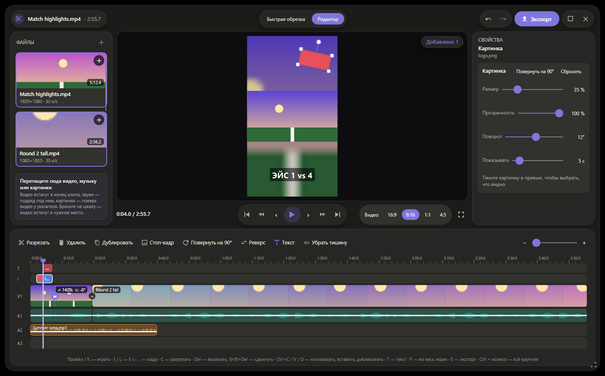

<p align="center">
  
</p>
<p align="center">
  
</p>

<p align="center">
  <a href="https://github.com/flexeykinDev/Filee/releases/tag/private-2.0.0-1"><b>Скачать (Windows, Linux, macOS)</b></a> ·
  <a href="#clip"><b>Видеоредактор</b></a> ·
  <a href="https://github.com/KnifeLemon/Filee"><b>Оригинальный Filee</b></a> ·
  <a href="#build">Собрать самому</a>
</p>

Это неофициальная сборка [Filee](https://github.com/KnifeLemon/Filee), бесплатного конвертера файлов от
[KnifeLemon](https://github.com/KnifeLemon). Зажимаете <kbd>Ctrl</kbd>, тянете файл, и у курсора открывается
кольцо форматов. Код взят из оригинала, сверху — отключённые автоподключения к серверам, пиксельная тема и
видеоредактор, которых в оригинале пока нет.

<a id="diff"></a>


- **Нет проверки обновлений.** Оригинал раз в 6 часов спрашивает `api.github.com` о новой версии. Здесь все запросы
  этой службы отклоняются ещё до подключения, а таймер не запускается.
- **Нет самообновления.** Оригинал умеет сам скачать и запустить официальный установщик, который заменил бы эту
  сборку на чужую. Здесь это отключено. Галочка «Проверять обновления» выключена по умолчанию.
- **Видеоредактор** «Вырезать клип» и **«Склеить видео»** прямо в кольце, [подробнее ниже](#clip). Предложены в
  оригинал: [KnifeLemon/Filee#326](https://github.com/KnifeLemon/Filee/pull/326).
- **Видеокарта по умолчанию.** Видео кодирует видеокарта (NVIDIA, Intel, AMD, Apple), если она есть, — и в редакторе,
  и в обычной конвертации. Если не вышло, Filee сам повторит на процессоре.
- **Масштаб окон:** <kbd>Ctrl</kbd> + колесо, <kbd>Ctrl</kbd> + <kbd>+</kbd> / <kbd>-</kbd>, <kbd>Ctrl</kbd> + <kbd>0</kbd> —
  сбросить.
- **Пиксельная тема** (Настройки → Тема): ступенчатые углы, зерно, точечные цифры, лавандовый акцент.
- Всё остальное — `main` оригинала без изменений, вместе с исправлениями, которые пришли из этого форка и уже приняты
  в оригинал: [#310](https://github.com/KnifeLemon/Filee/pull/310), [#311](https://github.com/KnifeLemon/Filee/pull/311),
  [#312](https://github.com/KnifeLemon/Filee/pull/312), [#313](https://github.com/KnifeLemon/Filee/pull/313),
  [#315](https://github.com/KnifeLemon/Filee/pull/315).

<a id="clip"></a>


На обратной стороне кольца видео (<kbd>Tab</kbd> или колесо мыши) есть **«Вырезать клип»** и **«Склеить видео»**.

### Быстрая обрезка

Бросьте видео на «Вырезать клип» — за минуту получится нарезка на 15–60 секунд:

<p align="center"></p>

- Сверху всё видео: тяните метки начала и конца, кнопки 15 / 30 / 60 с ставят длину, <kbd>Z</kbd> приближает шкалу.
- <kbd>Пробел</kbd> проигрывает клип со звуком ровно так, как он сохранится; <kbd>C</kbd> режет кусок,
  <kbd>Delete</kbd> вырезает. Вырезали лишнее — потяните край куска, и он вернётся.
- Скорость 0,25×–4×, громкость куска, «Убрать тишину», музыка на A2, нарастание и затухание.
- Один кусок без эффектов копируется мгновенно и без потерь.

### Редактор

Кнопка **«Редактор»** открывает полный монтаж — как в CapCut, только локально:

<p align="center"></p>

- **Несколько видео, звуков и картинок.** Перетащите файлы в панель «Файлы» или прямо на шкалу. Видео встают в
  конец клипа, звуки — подряд друг за другом, картинки — поверх видео у указателя.
- **Дорожки:** T — тексты, I — картинки, V1 — видео, A1 — его звук, A2, A3… — свои звуки (до 8 дорожек). Звуки
  тянутся по времени и между дорожками, края подрезаются, громкость — линией.
- **Кадр 16:9, 9:16, 1:1, 4:5** для YouTube, Shorts, TikTok и Instagram. Видео другой формы — целиком с полосами,
  обрезанным или на размытом фоне. В превью видео, картинки и тексты **двигаются, растягиваются за угол и
  поворачиваются** за круглую ручку (с прилипанием к 0°, 90°…).
- **Тексты:** заголовок, подпись снизу или метка; любой шрифт компьютера, цвет, размер, прозрачность, поворот.
  В клип текст попадает ровно таким, каким он в превью.
- **Картинки поверх видео:** логотип, стикер, водяной знак — размер, прозрачность, поворот, сколько показывать.
- **Переходы** между кусками: плавный, через чёрное, только звук. **Стоп-кадр**, **задом наперёд**, плавное
  **ускорение и замедление** куска, поворот на 90°.
- **Звук клипа:** выровнять громкость (EBU R128), убрать шум, подтянуть тихую речь, музыка тише под речью.
- **ПКМ везде:** по куску, пустоте, переходу, тексту, картинке, звуку и файлу в панели — там же «Убрать из проекта»
  (вместе со всеми кусками этого файла) и «Показать в папке».
- <kbd>Ctrl</kbd>+<kbd>Z</kbd> / <kbd>Ctrl</kbd>+<kbd>Y</kbd> для всего, <kbd>Ctrl</kbd>+<kbd>C</kbd> / <kbd>V</kbd> /
  <kbd>D</kbd>, <kbd>J</kbd> / <kbd>K</kbd> / <kbd>L</kbd>, <kbd>,</kbd> <kbd>.</kbd> — кадр, <kbd>T</kbd> — текст,
  <kbd>F</kbd> — во весь экран, <kbd>E</kbd> — экспорт, <kbd>Alt</kbd> + колесо — масштаб шкалы.

**Экспорт** (<kbd>E</kbd>): готовые настройки «YouTube 1080p», «Shorts / TikTok 9:16», «Discord до 10 МБ»,
«Telegram до 50 МБ» или свои — формат (H.264 — играет везде, HEVC — вдвое меньше, WebM, GIF), разрешение, частота кадров, качество, предел
размера. Видеокарта включена по умолчанию. «Каждый кусок — отдельным файлом» сохраняет несколько моментов одного
видео за раз.

### Склеить видео

Перетащите на «Склеить видео» сразу несколько файлов — откроется список: порядок меняется стрелками, затем
«Склеить». Видео одного формата склеиваются за секунды без перекодирования, разные — перекодируются в один
кадр. Кнопка «Открыть в редакторе» откроет их в редакторе с переходами.

Для видео нужен FFmpeg: Настройки → Движки → «Установить» (на macOS — `brew install ffmpeg`). Звук в превью играет
`ffplay` из той же сборки FFmpeg.

<a id="network"></a>


Трекеров, аналитики и уникальных идентификаторов в коде нет ни в оригинале, ни здесь. В сеть сборка выходит только
когда вы сами что-то нажали:

| Действие | Куда |
|---|---|
| «Установить» у движка (Настройки → Движки) | официальные сайты движков, см. ниже |
| Перетащить картинку или ссылку прямо из браузера | адрес, который вы перетащили |
| Ссылки GitHub и «Помочь» | открываются в вашем браузере |

Редактор в сеть не ходит: кадры, звук, картинки и шрифты читаются с диска.

<a id="engines"></a>


Картинки, PDF, документы Office, архивы, шрифты и 3D работают без движков. Движки нужны для видео, аудио и редких
форматов. Каждый файл закреплён в [`engines.json`](../src/Filee.Engines/Infrastructure/engines.json) по SHA-256:
файл с другим хешем Filee выбросит и не установит.

| Движок | Источник |
|---|---|
| FFmpeg (видео, аудио, редактор) | Windows: [gyan.dev](https://github.com/GyanD/codexffmpeg), на эти сборки ссылается ffmpeg.org; Linux: [BtbN/FFmpeg-Builds](https://github.com/BtbN/FFmpeg-Builds); macOS: из системы (Homebrew) |
| LibreOffice | download.documentfoundation.org |
| Pandoc | [jgm/pandoc](https://github.com/jgm/pandoc) |
| calibre | download.calibre-ebook.com |
| 7-Zip | [ip7z/7zip](https://github.com/ip7z/7zip) |
| rhwp (HWP) | [edwardkim/rhwp](https://github.com/edwardkim/rhwp) |
| Ghostscript | conda-forge, пакет сообщества, не Artifex |

<a id="install"></a>


Всё лежит на [странице релиза](https://github.com/flexeykinDev/Filee/releases/tag/private-2.0.0-1), хеши — в
`*-SHA256SUMS.txt` рядом с каждым файлом.

**Windows 10/11.** Скачайте `Filee-2.0.0-win-Setup.exe` и сверьте хеш:

```powershell
Get-FileHash .\Filee-2.0.0-win-Setup.exe   # DB9B896F519F77DAD859B4D85253F22B838F08A019C8F0B355E51DD9551E6E4C
```

Установщик не подписан, поэтому SmartScreen предупредит: «Подробнее» → «Выполнить в любом случае». Ставится поверх
прежней версии этой сборки с сохранением настроек. Не соглашайтесь на обновление из официального Filee: оно заменит
эту сборку. Тихая установка в свою папку без прав администратора:
`Filee-2.0.0-win-Setup.exe /SILENT /CURRENTUSER /DIR="D:\Apps\Filee"`.

**Linux** (Ubuntu 22.04+ и другие с glibc 2.35+; x64 и arm64). Нужен Python 3 и системные библиотеки — полный
список в `INSTALL.txt` внутри архива.

```bash
tar -xzf Filee-2.0.0-linux-x64.tar.gz && cd Filee-2.0.0-linux-x64
./install.sh      # в меню приложений и ~/.local/bin/filee, без root
```

Жесты над файлами работают в X11 (и XWayland); в Wayland — окно для перетаскивания и пункт в файловом менеджере.

**macOS 13+** (Apple Silicon — `osx-arm64`; пакета для Intel в этом релизе нет):

```bash
tar -xzf Filee-2.0.0-osx-arm64.tar.gz && cd Filee-2.0.0-osx-arm64
./install.sh      # Filee.app в ~/Applications и ~/.local/bin/filee
brew install ffmpeg
```

Сборка подписана ad-hoc и не нотаризована: при первом запуске «Системные настройки → Конфиденциальность и
безопасность → Всё равно открыть». Для жестов разрешите Filee в «Универсальном доступе».

**Как открыть кольцо форматов:**

| Способ | Что сделать |
|---|---|
| Перетаскивание | Тяните файл левой кнопкой и зажмите <kbd>Ctrl</kbd>. Кнопку отпускайте на нужном формате |
| Клавиатура | Выделите файл и нажмите <kbd>Ctrl</kbd> + <kbd>Alt</kbd> + <kbd>Space</kbd> |
| Меню | ПКМ по файлу → «Конвертировать с помощью Filee» (macOS — быстрое действие Finder) |
| Окно | Перетащите файл в зону на главной странице Filee |

Жесты по умолчанию работают над Проводником и рабочим столом. Чтобы они работали везде, откройте
«Горячие клавиши» и выберите область «Везде».

<a id="build"></a>


Нужны [.NET 10 SDK](https://dotnet.microsoft.com/download) и [PowerShell 7](https://github.com/PowerShell/PowerShell).

```bash
git clone -b private-build https://github.com/flexeykinDev/Filee.git
cd Filee
pwsh build/fetch-fonts.ps1
pwsh build/build-installer.ps1
```

Установщик появится в `Releases/`. Пакеты для Linux и macOS собирает workflow «Linux and macOS packages»
(Actions → Run workflow) — там же прогоняются все тесты на этих системах. Чтобы подтянуть новую версию оригинала,
влейте его `main`:

```bash
git fetch https://github.com/KnifeLemon/Filee.git main
git merge FETCH_HEAD
```

---

<sub>MIT, © Myeonggu Kim (KnifeLemon) и участники проекта Filee. Эта сборка не связана с автором и не
поддерживается им. Ошибки самого Filee сообщайте [в оригинальный репозиторий](https://github.com/KnifeLemon/Filee/issues).</sub>
